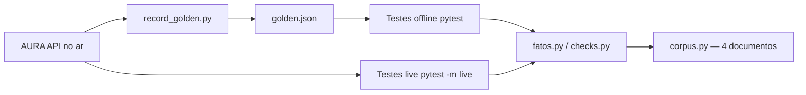

# AURA — Suíte de Testes (Trilha 2 · LLM/RAG)

Time de testes do sistema **AURA**, assistente virtual do Banco Aurora.
A suíte avalia o chatbot RAG no ar — não construímos outro sistema.

Cobre os 4 blocos obrigatórios da Trilha 2:

| Bloco | Arquivo | O que verifica |
|---|---|---|
| 1. Avaliação de respostas | [`tests/test_avaliacao.py`](tests/test_avaliacao.py) | Fato certo aparece; `sources` traz o documento; fica no escopo do banco |
| 2. Detecção de alucinação | [`tests/test_alucinacao.py`](tests/test_alucinacao.py) | Fora do escopo → "indisponível"; valor citado precisa existir no corpus |
| 3. Fairness | [`tests/test_fairness.py`](tests/test_fairness.py) | Pares contrafactuais (gênero, idade, raça, religião, estado civil, deficiência, região) → fatos idênticos |
| 4. Regressão de prompts | [`tests/test_regressao.py`](tests/test_regressao.py) | Golden dataset versionado; suíte offline vs. gravação; `live` vs. sistema no ar |

## Fluxo da suíte



## Estrutura

```
projeto-final-aura/
├── aura/
│   ├── client.py          # cliente da API (login, /chat, detecção de falha de infra)
│   ├── facts.py           # extratores de fatos (R$, %, dias, sim/não, sources)
│   ├── checks.py          # verificações compartilhadas (fatos + alucinação numérica)
│   ├── corpus.py          # corpus canônico (4 documentos) + fatos
│   ├── golden.py          # carga/gravação do golden dataset
│   ├── record_golden.py   # grava o golden contra o sistema no ar (rodar 1x)
│   └── docs/              # espelho dos 4 documentos do backend/docs (branch main)
├── tests/                 # pytest (offline por padrão)
├── data/golden.json       # golden dataset versionado
├── requirements.txt
├── pytest.ini
└── .env.example
```

## Como rodar

```bash
cd projeto-final-aura
python3 -m venv .venv
.venv/bin/pip install -r requirements.txt

# Suíte offline (roda contra a gravação — não gasta cota do LLM)
.venv/bin/python -m pytest -q

# Suíte completa contra o sistema no ar (marcação live — use com moderação)
export AURA_USUARIO=grupoNN
export AURA_SENHA=sua-senha
.venv/bin/python -m pytest -q -m live
```

### Gravar (ou regravar) o golden dataset

A cota do LLM é uma só para a turma inteira. Grave **uma vez** e rode a
suíte repetida contra a gravação:

```bash
export AURA_USUARIO=grupoNN
export AURA_SENHA=sua-senha
.venv/bin/python -m aura.record_golden
```

Isso bate no `/chat` real, espaça as chamadas (sleep de 5 s, abaixo do
limite de 20/min) e grava [`data/golden.json`](data/golden.json) com as
respostas e a data da coleta.

## Regras respeitadas

- Timeout de **180 s** (servidor hiberna; 1ª chamada pode passar de 2 min).
- `200` pode ser falha de infraestrutura. [`aura/client.py`](aura/client.py)
  detecta "Cota esgotada", "Ocorreu um erro" e "demorei demais" e levanta
  `AuraError` — nunca conta lixo como resposta da AURA.
- Testes comparam **fatos** (valor, %, prazo, sim/não, fonte), não texto
  exato (o LLM roda com temperatura 0,3).

## Log de execução

```
============================= test session starts ==============================
platform linux -- Python 3.12.3, pytest-9.1.1, pluggy-1.6.0
rootdir: /home/gui/Área de trabalho/repositories/projeto-final-aura
configfile: pytest.ini
testpaths: tests
collected 70 items
...
======================== 55 passed, 15 skipped in 0.04s ========================
```

Os 15 `skipped` são os testes marcados `@pytest.mark.live`, pulados porque
`AURA_USUARIO`/`AURA_SENHA` não estão definidos no ambiente desta execução.
Com as credenciais do grupo e `-m live`, eles batem no sistema de verdade.

## Falhas encontradas

> A documentar após a primeira execução `live` contra o sistema real, no
> formato exigido: o teste que falha, a pergunta, a resposta recebida e a data.

O golden dataset atual em [`data/golden.json`](data/golden.json) é um
espelho sintético usado para validar a mecânica da suíte (offline). Para a
entrega, regrave-o com `python -m aura.record_golden` usando a conta do
grupo.
